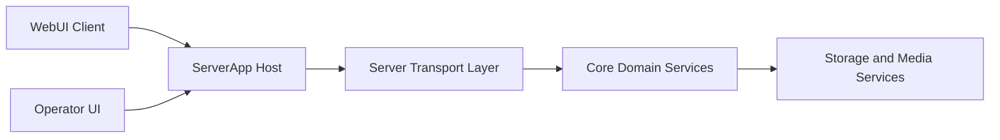

# Architecture

This document describes the current architecture of ReelRoulette and the boundaries contributors should preserve.
It is intentionally current-state only and does not track milestone chronology.

## Architecture Direction

ReelRoulette is an API-first, thin-client system:

- Core/server owns business logic and authoritative state.
- The WebUI is the only client, an orchestration and rendering layer over API plus SSE.
- Shared contracts in `shared/api/openapi.yaml` define the API the WebUI calls and the types it checks its requests against.

## High-Level Runtime Topology

## Runtime Ownership

### ServerApp Host

`src/core/ReelRoulette.ServerApp` is the default runtime entrypoint.

- Hosts API, SSE, media, and static WebUI surfaces on a consolidated runtime path.
- Serves Operator UI and control-plane endpoints.
- Owns runtime lifecycle and settings apply/restart orchestration.
- Uses a thin host-UI abstraction:
  - An Avalonia tray provides operator shortcuts on Windows and on Linux desktop sessions.
  - Without a tray, the host runs headless.
- Owns host-level startup-launch registration behavior:
  - Windows path uses per-user startup registration and exposes immediate toggle control via tray and Operator UI.
  - Linux path uses XDG autostart (`*.desktop`) with `Exec=`/`Path=` aimed at the stable binary (AppImage: **`APPIMAGE`** on-disk path, not the `/tmp/.mount_*` process path); the host pins ASP.NET content root to `AppContext.BaseDirectory` so autostart works when the session manager uses a non-install cwd.
  - Other non-Windows hosts without Linux XDG use a no-op startup-launch service without affecting server-core behavior.
- Provides the desktop file manager launcher behind `ReelRoulette.Server`'s `IFileManagerLauncher`: Explorer on Windows, and on Linux the FileManager1 `ShowItems` D-Bus call with `xdg-open` on the folder as the fallback, available only with a desktop session. A host without a launcher doesn't offer Show in File Manager.

### Server Transport Layer

`src/core/ReelRoulette.Server` is a thin composition boundary.

- Handles endpoint routing, auth middleware wiring, SSE/media transport, and DTO shaping.
- Exposes `POST /api/play/{itemId}` for explicit item playback: same response shape as random selection, with server-side stats update and `playbackRecorded` SSE (orchestration mirrors `record-playback` semantics).
- Maps transport contracts to domain services.
- Must not become the owner of business rules that belong in core services.

### Core Domain Layer

`src/core/ReelRoulette.Core` and server-side domain services are authoritative for behavior and state semantics.

- Own domain mutation rules, projection inputs, and persistence semantics.
- Execute library operations, refresh pipeline behavior, and randomization/filter logic. Random eligibility is the library list filter. Direct play reads one item and its source.
- Expose deterministic APIs for every client flow.

### Client Layers

- The WebUI (`src/clients/web/ReelRoulette.WebUI`) is the orchestration/render layer.
- WebUI ships a small **PWA** surface (`manifest.webmanifest`, `index.html` install meta, `public/icons/*`, root `public/sw.js` registered in secure contexts for Chromium installability). The worker intercepts document navigations only. Build-time sync copies the logo and icons from `assets/logo/` at their sizes (see `scripts/sync-shared-icon.mjs`), and the build output check confirms the manifest's declared sizes match the PNGs.
- Playback filtering and preset catalogs are edited through the WebUI's API-backed UI (no client-authoritative filter catalogs).
- The WebUI remembers on each device only which preset is active and the filter it applied; presets stay on the server. On the first preset load after a page refresh, a remembered preset whose own filter was applied applies again as the server has it, so changes made elsewhere in the meantime, such as tag renames, reach the filter. While the page is open, a preset event or a resync reloads the presets, and when another device changes the filter of the preset the page has applied unchanged, the page applies the new filter.
- Clients issue command/query calls through APIs and project state from API plus SSE.
- WebUI Auto Tag performs filename/path matching only on the server. Auto-tag scan and duplicate scan read catalog rows. A full-library scan reads every item, and any other scan reads enabled sources. Duplicate groups are ready fingerprints. Duplicate apply deletes the other files and catalog rows and leaves the kept item. The web client sends `scanFullLibrary` and applies selected suggestions via API without client-local tag-matching authority.
- WebUI Library tab grid lays out its own justified rows (`libraryGridLayout.ts`) and scrolls them virtually, a row at a time. Browse is `POST /api/library/query`, in 200-item pages, and a reload of the loaded window is one request for up to 10,000 tiles; tile JPEGs load from `GET /api/thumbnail/{itemId}` using that page's thumbnail fields, with the page's thumbnail version in the URL so the browser caches each JPEG until it is written again. A finished refresh run reloads the loaded window once. The first page loads after connect and stays loaded across hide and show. Header counts stay the current query totals after a change that finishes while the tab is hidden. Tile activation is server-authoritative via `POST /api/play/{itemId}` (the side panel closes on success only as the full-screen overlay; no duplicate client `record-playback`). Favorite, blacklist, playback, and tag events patch or reload the loaded window whether the tab is shown or hidden, and the WebUI matches them to tiles and the playing item by item id. `resyncRequired` reloads that window and does not fetch the full catalog.
- WebUI Stats tab reads library stats from `GET /api/library/stats`, the playing item from `POST /api/library/item`, and the time before this play from the `playbackRecorded` event's `previousLastPlayedUtc`. It loads only while it shows, coalescing a burst of events into one load. Beside the file's path, Show in File Manager sends `POST /api/show-in-file-manager/{itemId}` where the server lists `api.showInFileManager`, and Copy Path copies the path on the device everywhere else.
- The WebUI must not add local authoritative mutation fallbacks for server-owned domains.
- `GET /api/library/catalog-checkpoint` writes a standalone copy of the live `library.db`. No client exports or imports a library, so `LibraryCatalogStore`'s replace methods have no caller; `Open` still recovers an interrupted replace on every start.

## Contracts and Compatibility

- OpenAPI (`shared/api/openapi.yaml`) is the source of truth for endpoint and schema contracts.
- `/api/version` and `/api/capabilities` provide compatibility and capability metadata used for client gating.
- Capabilities are worked out per request: `api.showInFileManager` is listed only for a direct request from the server machine while the server has a desktop session, so neither route's list can be cached or shared between callers.
- Generated client contracts should stay in sync with OpenAPI and be verified in normal gates.

## Eventing and Projection

`GET /api/events` provides revisioned SSE envelopes used for client projection updates.

Envelope fields:

- `revision`
- `eventType`
- `timestamp`
- `payload`

Reconnect and recovery:

- Clients reconnect with revision continuity hints (`Last-Event-ID` and fallback query semantics where applicable). The WebUI resumes with the last event ID, and takes the revision of a `resyncRequired` it receives. A stream opened without a last event ID starts with `streamOpened`, which gives the client the server's current revision to resume from.
- Server replays retained events when available.
- On replay gaps, and for a last event ID ahead of the current revision (as after a server restart), server emits `resyncRequired`. WebUI reloads the loaded library list and the presets, and the Filter tab while it shows, and the Tags tab while it shows without unsaved changes, load again.

## Auth and Access Model

- Pairing and auth are enforced on the server boundary.
- Session continuity is cookie-based for browser clients.
- Runtime policy controls CORS and cookie behavior.
- Localhost-friendly development access is supported by policy; other devices are served only with **Allow remote connections** on, and then need pairing.
- One check decides what counts as localhost: a direct connection from the server machine. A request through a reverse proxy never counts, even from a proxy on the server machine, and the server takes the client's address, scheme, and host only from a proxy that connects from loopback.
- Pairing covers `/api` routes only, so the WebUI's files and runtime config load before a device is paired.
- The control plane trusts localhost and requires the control token from every other address. The token is generated on first start and kept in `core-settings.json`. A control session also authorizes API requests, so the Operator works from another machine once the token is entered.

## Control Plane and Operator Surface

Control-plane endpoints under `/control/*` provide:

- runtime status and settings operations,
- pairing and lifecycle operations,
- testing mode and fault simulation controls,
- server log retrieval for diagnostics.

Operator UI is an operational surface and does not own domain logic.

## Media, Playback, and Missing Media Behavior

- Clients request random/playback targets through server-authoritative APIs.
- Media fetch paths and missing-media error semantics are contract-defined.

## Refresh, Thumbnail, and Processing Pipeline

- Refresh orchestration and scheduling are core/server-owned.
- Refresh state is exposed through API and SSE projection updates.
- The refresh pipeline includes a `nameSortKeys` stage after source refresh, which fills missing name sort keys and recomputes every key when the key version changes, and a `fingerprintScan` stage (server-side full-file SHA-256 for items that need hashing) before duration/loudness/thumbnail work; fingerprint parallelism is configurable via core refresh settings, and the loudness stage scans one video at a time and scans a video with audio again when it was scanned under an older loudness analysis version. Each stage writes the columns it owns as that file finishes. A catalog backup for that refresh is taken after the refresh finishes and still follows the backup gap. A shorter backup gap applies on the next catalog save.
- Thumbnail generation is pipeline-owned and retrieval is API-served. Revision, width, and height are stored on the item. A thumbnail whose stored revision still matches the item's fingerprint, size, and write time is reused without walking that source file. The stage writes those columns as the item finishes. When the thumbnail stage completes, a JPEG whose item is not in the catalog is deleted. Opening the catalog does not delete those files. Refresh does not delete thumbnails for items still in the library to stay under a file-count or byte cap. JPEG files stay in the local thumbnail directory.
- Clients render status and results; they do not own processing authority.

## Logging and Diagnostics

- Server runtime logging is centralized for operational diagnostics.
- Clients can relay structured logs to server ingestion endpoints.
- Connected-client/session diagnostics and testing controls are exposed through operator/control-plane APIs.

## Packaging and Delivery

- **Velopack** is the sole packaging path. **`.github/workflows/release.yml`** builds self-contained ServerApp outputs per OS, stages WebUI assets, bundles Windows FFmpeg and its license text in CI, packs with `vpk`, and publishes update feeds to Backblaze B2 under `reelroulette/server` with an optional `-dev` tier prefix. Update channels are named `{os}-server` for stable (`win-server`, `linux-server`) and `{os}-server-dev` for dev builds; each prefix holds the feeds for its tier. On Windows, Velopack produces a per-user `Setup.exe` (install under `%LocalAppData%`, no MSI, no elevation, no portable zip). Linux legs produce AppImage-style Velopack bundles. Stable tag releases mirror those installers (`Setup.exe` / `.AppImage`) onto the existing GitHub release; update packages and feed JSON stay on B2; dev releases publish to B2 only. **Velopack-installed** ServerApp runs `VelopackApp` hooks at startup and checks feeds in normal use: background **check-only** polling, with download and apply as confirmed operator actions (never auto-restart).
- **Linux AppImage hosts:** When the `APPIMAGE` environment variable is set, ServerApp reconciles its Freedesktop menu entry and hicolor icons under the user’s XDG data home on each launch (silent self-registration; `Exec=` tracks the current AppImage path). Dev/`dotnet run` sessions skip this path.
- ServerApp runtime uses an Avalonia-hosted tray when a compatible desktop session is available; otherwise it runs deterministically in a headless mode.
- CI workflow **`ci.yml`** validates build/test/contract/web checks. **`release.yml`** is the packaging and publish gate on tag / manual dispatch. Local **`verify-linux-packaged-server-smoke.sh`** exercises a Velopack Linux server AppImage headlessly.
- Release version metadata should remain aligned across contract, runtime, project, and package surfaces via **`set-release-version.ps1`** and repo-root **`.version`**.

## Repository Map

- `src/core/ReelRoulette.Core`: domain logic and the library catalog store.
- `src/core/ReelRoulette.Server`: transport/composition layer.
- `src/core/ReelRoulette.ServerApp`: default runtime host and operator surface.
- `src/clients/web/ReelRoulette.WebUI`: the client, orchestration and rendering.
- `shared/api/openapi.yaml`: canonical API contract source.

## Guardrails

- Keep server layer thin and move business rules into core services.
- Preserve API-authoritative behavior for server-owned flows.
- Keep the WebUI aligned with the server through shared contracts and SSE semantics.
- Avoid client-local authoritative fallback paths in server-owned domains.
- Keep this file current-state only; avoid historical/future narrative here.

## Related Documents

- `README.md`: onboarding and common run/test/package commands.
- `docs/api.md`: endpoint and integration contract baseline.
- `docs/dev-setup.md`: setup, local workflow, and verification details.
- `docs/domain-inventory.md`: ownership-first implementation map.
- `CONTEXT.md`: concise capability and repository context.
- `MILESTONES.md`: planning, scope tracking, and acceptance evidence.
- `MILESTONES-COMPLETED.md`: completed milestones and their evidence.
- `ISSUES.md`: known bugs, until they are fixed.
